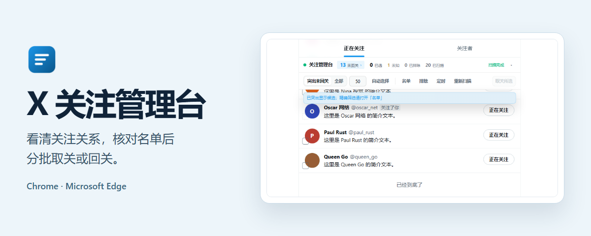
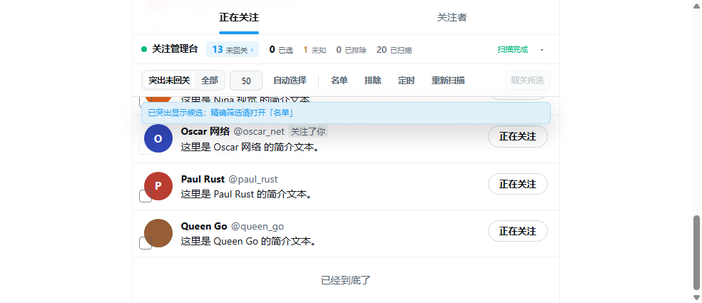
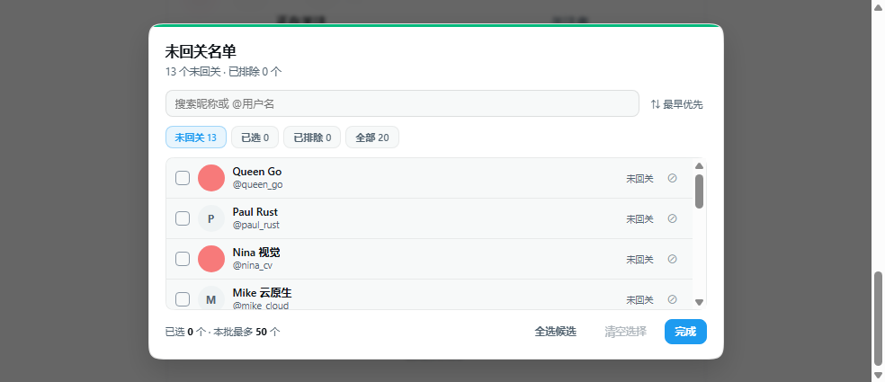
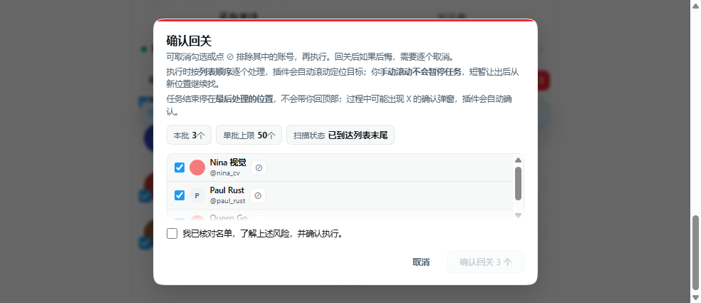
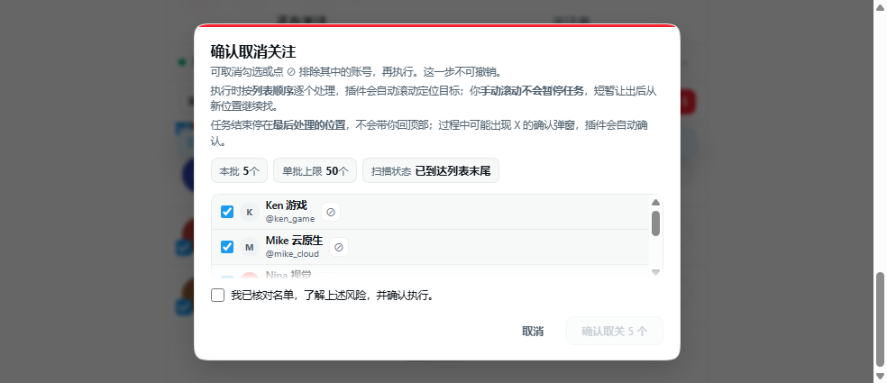
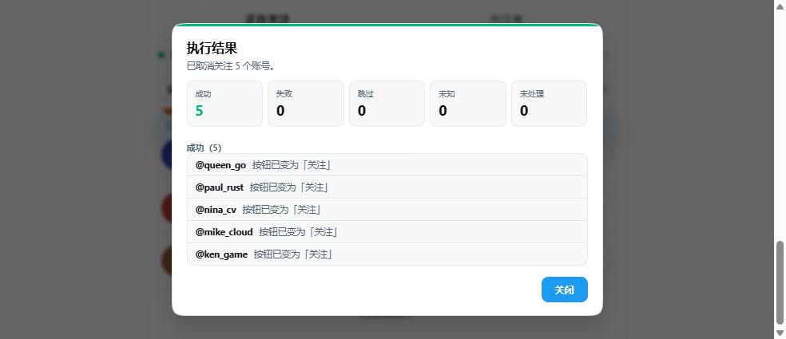
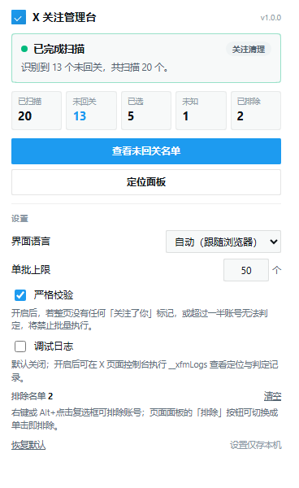

<h1 align="center">
  
</h1>

<p align="center"><strong>v1.0.0</strong> · 桌面 Chrome / Microsoft Edge · Manifest V3 · 本地运行</p>


<p align="center">
  <a href="../../releases/tag/v1.0.0"><strong>下载 v1.0.0</strong></a>
  · <a href="#安装">安装说明</a>
  · <a href="../../issues/new/choose">反馈与建议</a>
</p>

---

## 功能与界面

在 X 的「正在关注」列表识别未回关账号，在「关注者」列表挑选需要回关的人。先扫描、再选择，只有核对名单并确认后才执行。



> 图片是插件在本地模拟 X 页面中的运行截图，使用合成账号展示界面，不包含个人关注列表。

| 看清关系 | 挑选与保护 | 核对后执行 |
| --- | --- | --- |
| 区分未回关、已回关和未知状态；停止扫描会保留已有结果。 | 搜索昵称或用户名，勾选候选，把想保留的人加入排除名单。 | 确认名单与数量后分批处理，结束后分别展示成功、失败和待复查结果。 |

- **扫描与恢复**。可暂停或停止扫描。中断的扫描进度会在本机按账号和列表保存，返回同一列表时可以恢复。
- **批次保护**。执行前复查列表身份、严格校验和单批上限。切换列表后清空旧选择。检测到页面已有原生确认窗口时，停止当前批次。
- **显示设置**。支持浅色、深色界面和九种界面语言。弹窗可跟随浏览器语言，设置保存失败时会提示并恢复上一次保存的值。

## 名单管理与粉丝回关

| 搜索、勾选、排除 | 核对待回关名单 |
| :---: | :---: |
| [](docs/screenshots/02-roster.png) | [](docs/screenshots/05-followback.png) |

排除名单保存在本机。页面使用「突出候选」保留原生列表高度；需要只看某一类账号时，打开名单窗口筛选。

## 执行前核对，执行后复查

| 确认本批名单与数量 | 查看逐个账号的处理结果 |
| :---: | :---: |
| [](docs/screenshots/03-confirm.png) | [](docs/screenshots/04-result.png) |

开始时优先定位本批最靠后的目标，再向前逐个处理。虚拟列表变化时可能需要校正位置；无法确认的结果会单独列出，方便人工复查。

## 安装

目前尚未上架 Chrome Web Store 或 Microsoft Edge Add-ons。桌面版 Chrome 和 Edge 都可以通过开发者模式加载同一份扩展。

### 1. 下载并解压

点击 [下载 v1.0.0 源码 ZIP](../../archive/refs/tags/v1.0.0.zip)，或在 [发布页](../../releases/tag/v1.0.0) 的 **Assets** 下选择 **Source code (zip)**。下载后，在 Windows 文件管理器里右键 ZIP，选择「全部解压缩」。将解压后的目录放到方便长期保留的位置。

### 2. 打开开发者模式并添加插件

新开一个标签页，点击浏览器窗口**最上方平时输入网址或搜索关键词的那一栏**。复制下面对应的完整地址，粘贴进去，然后按 **Enter**。扩展管理页打开后，再找开发者模式开关。

**Chrome**

1. 复制并粘贴 `chrome://extensions/`，按 Enter。
2. 看**扩展管理页面内容的右上角**。在「开发者模式」（Developer mode）文字旁边有一个开关，点击开关开启。
3. 开启后，看**页面顶部左侧**新出现的一排按钮，点击「加载已解压的扩展程序」（Load unpacked）。

**Microsoft Edge**

1. 复制并粘贴 `edge://extensions/`，按 Enter。
2. 看**扩展管理页面的左侧栏**，找到「开发人员模式」（Developer mode）文字旁边的开关，点击开启。如果左侧栏收起来了，先点页面左上角的菜单按钮展开。
3. 开启后，点击页面上方的「加载解压缩的扩展」（Load unpacked）。

### 3. 选中正确的文件夹

在选择窗口进入刚解压的目录，再进入里面的 **`x-follow-manager`** 子文件夹，点击「选择文件夹」。该文件夹打开后应直接看到 `manifest.json`。如果眼前只看到 `README.md` 和一个 `x-follow-manager` 文件夹，还需要进去一层。

扩展管理页出现「X 关注管理台」卡片且开关已开启，即已添加成功。回到 X，刷新页面，进入自己账号的「正在关注」或「关注者」列表，即可看到管理面板。

### 更新与排查

- **找不到加载按钮**。检查是否已打开扩展管理页并开启开发者模式。单位管理的浏览器若禁用了该功能，请联系管理员。
- **提示找不到清单文件**。重新选择直接包含 `manifest.json` 的 `x-follow-manager` 子文件夹。
- **已添加却看不到面板**。确认扩展在当前使用的浏览器配置中已开启，刷新 X，再进入自己的关注或粉丝列表。
- **更新扩展**。将新版扩展文件放到原来加载的目录，在扩展卡片上点「重新加载」，然后刷新 X。浏览器依赖这个目录运行扩展，请保留它。

## 设置与使用

<p align="center">
  
</p>

1. 在自己账号的关注或粉丝列表点击「开始扫描」。扫描阶段只读取页面；切到后台后会尽力继续，受限时切回页面可恢复。
2. 打开「名单」，搜索、勾选并排除需要保留的账号。
3. 核对本批人数与名单，勾选确认后执行。
4. 查看处理结果。遇到「结果未知」时先人工复查，避免重复执行。

**定时任务**。GitHub 下载的 `v1.0.0` 可以打开「定时」设置界面，实际定时执行处于关闭状态。使用已开启定时执行的版本时，请先在对应列表完成一次扫描，再保持浏览器窗口和绑定的 X 标签页打开。定时清理停留在自己账号的「正在关注」列表，定时回关停留在「关注者」列表。关闭浏览器、设备休眠或标签页被冻结，都可能导致任务错过执行时间。

## 反馈与建议

- **Bug 或功能建议**。可在 GitHub 提交反馈，也可以使用安全说明中列出的反馈邮箱。[GitHub Issues](../../issues/new/choose) · [反馈邮箱](SECURITY.md)
- 请注明扩展版本、浏览器版本、复现步骤和预期结果。截图、日志和账号信息请先脱敏；不要发送密码、Cookie 或访问令牌。
- 涉及可被利用的安全问题，请参阅安全说明，不要公开漏洞细节。

## 数据与使用边界

- **本地保存**：设置、排除名单和未完成扫描进度保存在扩展本地存储；扫描进度定期保存，但不能保证最后一次保存成功。没有项目后端、遥测或广告服务。参阅 [隐私说明](PRIVACY.md)。
- **登录与校验**：需要正常登录 X。扩展不索取密码或访问令牌；无法核实页面身份或关注关系时会阻止执行。
- **平台限制**：X 的自动化规则禁止用脚本操作网站。扩展在网页上批量取关或回关可能触发限流、验证或账号处置。参阅 [X 自动化规则](https://help.x.com/en/rules-and-policies/x-automation)。

<details>
<summary><strong>开发与测试</strong></summary>

需要 Node.js 22 或以上。

```sh
npm ci
npm test
npm run e2e -- interactionaudit
```

端到端测试会自行启动本地测试台，使用合成账号。可通过 `CHROME_PATH` 指定 Chrome 或 Edge 可执行文件。手动预览时运行 `npm run serve`，然后打开 `http://localhost:38080/alice/following`。

Windows 打包：`powershell -NoProfile -ExecutionPolicy Bypass -File tools/build.ps1`。

</details>

## 许可

[MIT](LICENSE)，作者 **Velpro**。允许商用、修改与分发，须保留版权声明与许可全文。第三方组件遵循各自许可证，详见 [第三方声明](NOTICE.md)。
